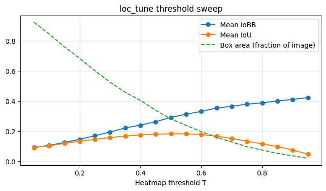
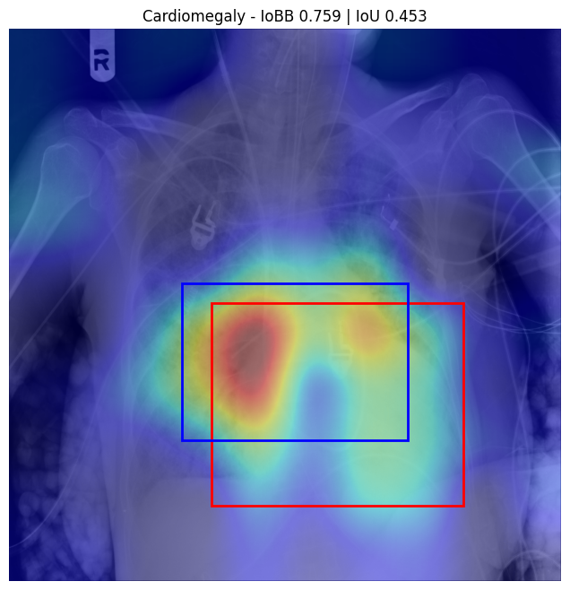
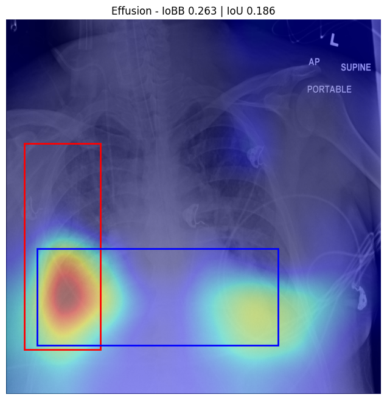
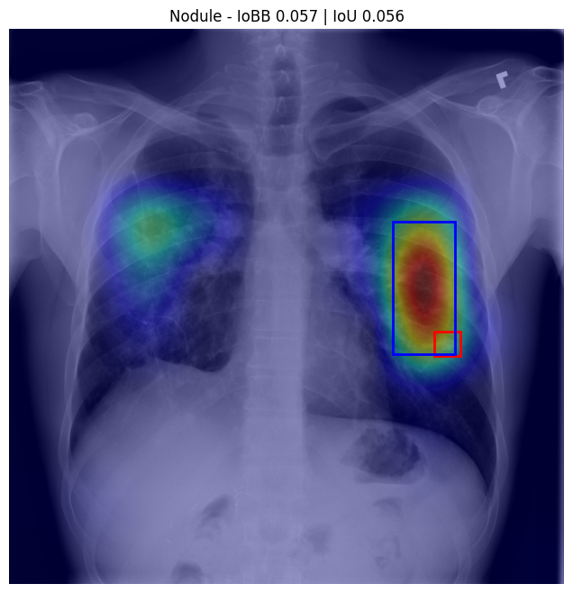

# Explainable Multi-Label Chest X-Ray Diagnosis

Multi-label classification of 14 thoracic pathologies from chest radiographs, with Grad-CAM explanations evaluated against radiologist-drawn bounding boxes.

Samsung Innovation Campus AI Capstone Project, Team Core (6 members).

> Research prototype. Not intended, validated, or suitable for clinical use.

---

## My contribution

I worked as the **XAI Specialist** for Team Core. In this repository, my contribution focuses on the Grad-CAM explainability and localization-evaluation pipeline:

- **Grad-CAM integration** with the final ConvNeXt-Tiny 320×320 BCE model
- **Target-layer selection** using `model.features[-1][-1].block[0]`
- **Class-specific heatmap generation** from raw class logits
- **Heatmap threshold tuning** on the dedicated `loc_tune` split, selected by mean IoU
- **Frozen-threshold evaluation** on the held-out `loc_report` split
- **IoBB localization evaluation** against radiologist-drawn bounding boxes, reported with IoU, box size, and a centre-box control
- **Class-wise localization analysis** for all 8 pathologies with bounding-box annotations
- **Representative examples** selected by class mean, not hand-picked
- **Reusable Grad-CAM / IoBB code** in `src/gradcam.py`
- **Technical documentation** in [Grad-CAM / IoBB Summary](docs/gradcam_iobb_summary.md)

My main notebook is:

[Grad-CAM / Localization Notebook](notebooks/convnext-gradcam-localization.ipynb)

Kaggle:

https://www.kaggle.com/code/layanabdullah11/convnext-gradcam-localization

The model-development notebooks, backend, frontend, and other team-level artifacts included in this repository are shared Team Core work and are kept here to show the project end-to-end.

---

## Problem

Chest X-ray classification can return model probabilities, but probabilities alone do not show which image regions influenced a prediction.

This project combines multi-label classification with Grad-CAM explainability so that a selected pathology prediction can be paired with a visual attention map.

My part of the project focused on checking whether those Grad-CAM regions actually overlap radiologist-annotated pathology regions, instead of relying only on how the heatmaps look.

---

## Data

The project uses a working subset of the [NIH ChestX-ray14](https://www.kaggle.com/datasets/nih-chest-xrays/data) dataset containing **31,077 X-rays from 11,907 patients**.

The classification subset contains 25,895 images, while the full working set also includes the dedicated localization splits.

Splits are defined at the **patient level** to avoid patient leakage. All pairwise split combinations share zero patients. Patients with radiologist-drawn bounding boxes are held out of the classification splits entirely and used only for Grad-CAM evaluation, split evenly so the heatmap threshold is never selected on the data it is reported on.

| Split | Images | Patients | Purpose |
|---|---:|---:|---|
| `train` | 18,013 | 7,930 | Model training |
| `val` | 3,978 | 1,699 | Hyperparameters and classification thresholds |
| `test` | 3,904 | 1,700 | Final classification evaluation |
| `loc_tune` | 2,606 | 289 | Grad-CAM threshold selection |
| `loc_report` | 2,576 | 289 | Final localization evaluation |

The model has **14 outputs**:

Atelectasis, Consolidation, Infiltration, Pneumothorax, Edema, Emphysema, Fibrosis, Effusion, Pneumonia, Pleural_Thickening, Cardiomegaly, Nodule, Mass, and Hernia.

`No Finding` is not a 15th model output. It is derived when no pathology probability crosses its class-specific threshold.

Kaggle inputs used by the notebooks:

- Images: [`nih-chest-xrays/data`](https://www.kaggle.com/datasets/nih-chest-xrays/data)
- Splits and bounding boxes: `iwmm10/chestxray-capstone-splits`
- ConvNeXt-Tiny checkpoint: output of the team notebook `rabehalmutire/01-convnext-training`

---

## Model

The team evaluated three CNN architectures on the same patient-level classification setup:

| Model | Input | Test Macro AUROC |
|---|---:|---:|
| ResNet50 | 224×224 | 0.7826 |
| DenseNet-121 | 224×224 | 0.7948 |
| **ConvNeXt-Tiny** | **320×320** | **0.8158** |

ConvNeXt-Tiny was also trained at a higher resolution, so part of the gap may come from the input size and not only the architecture.

The final model is **ConvNeXt-Tiny** with:

| | |
|---|---|
| Input size | 320×320 |
| Outputs | 14 pathology logits |
| Loss | `BCEWithLogitsLoss` |
| Optimizer | AdamW |
| Decision thresholds | Tuned per class on validation |
| Early stopping | Used during training |

The final ConvNeXt-Tiny checkpoint is not committed to GitHub because of file size.

---

## Classification results

| Metric | Value |
|---|---:|
| Test Macro AUROC | **0.8158** |
| Macro F1 @ 0.50 | 0.3034 |
| Macro F1 @ tuned thresholds | **0.4236** |
| Macro ECE | **0.0258** |

Threshold tuning improved macro F1 substantially compared with using a fixed 0.50 cutoff for every pathology.

Per-class AUROC, the BCE vs focal-loss comparison, and the sex / age / view-position robustness analysis are in the team's [ConvNeXt experiment summary](https://github.com/ABDULLHALSALHI/team-core-chest-xray/blob/main/docs/convnext_experiment_summary.md). Classification outputs and threshold files are under `results/`.

---

## Explainability

Grad-CAM was applied to the final ConvNeXt-Tiny model to generate class-specific heatmaps.

The target layer is `model.features[-1][-1].block[0]`, the depthwise convolution of the last block in the last ConvNeXt stage. Gradients are taken from the raw class logit.

Each heatmap is thresholded at `T`, and the predicted box is the rectangle around the pixels that pass.

### Metrics

- **IoBB** = intersection area / predicted box area, as defined for ChestX-ray14 (Wang et al., 2017)
- **IoU** = intersection area / union area
- **Box area** = predicted box area / image area
- **Centre control** = IoBB of a same-sized box placed at the image centre, ignoring the heatmap

IoBB never gets worse when the predicted box gets smaller, so it is always reported next to IoU, box size, and the centre control.

### Threshold selection

`T` was swept from 0.05 to 0.95 on `loc_tune` and selected by **mean IoU**.

<p align="center">
  
</p>

Mean IoBB keeps rising up to `T = 0.95` while the box shrinks to about 2% of the image. Mean IoU peaks in the middle, so it gives a real optimum.

**Selected threshold: T = 0.55**, frozen before evaluation on `loc_report`.

### Localization protocol

The evaluation covers all 8 pathologies with bounding-box annotations:

Atelectasis, Cardiomegaly, Effusion, Infiltration, Mass, Nodule, Pneumonia, Pneumothorax

The annotation label `Infiltrate` is mapped to the model label `Infiltration`. The classifier still predicts all 14 pathologies. The 8-class limit applies only to localization.

### Results on `loc_report`

Final evaluation included **373 image-class pairs**.

| Metric | Value |
|---|---:|
| Mean IoBB | **0.326** |
| Mean IoU | **0.179** |
| Mean box area | 23.6% of the image |
| IoBB ≥ 0.25 | **42.1%** |
| Centre control, IoBB ≥ 0.25 | 32.2% |

| Pathology | n | Mean IoBB | Mean IoU | IoBB ≥ 0.25 | Centre ≥ 0.25 |
|---|---:|---:|---:|---:|---:|
| Cardiomegaly | 81 | 0.760 | 0.302 | 92.6% | 96.3% |
| Pneumonia | 53 | 0.314 | 0.207 | 41.5% | 26.4% |
| Effusion | 44 | 0.258 | 0.189 | 34.1% | 11.4% |
| Mass | 30 | 0.220 | 0.153 | 33.3% | 16.7% |
| Atelectasis | 57 | 0.187 | 0.150 | 28.1% | 5.3% |
| Infiltration | 41 | 0.255 | 0.146 | 31.7% | 26.8% |
| Pneumothorax | 33 | 0.075 | 0.061 | 12.1% | 12.1% |
| Nodule | 34 | 0.060 | 0.057 | 5.9% | 0.0% |

What this shows:

- **Effusion, Atelectasis, Mass, and Pneumonia** clearly beat the centre control, so Grad-CAM points at the right region for these classes.
- **Cardiomegaly** has the highest IoBB, but the centre control scores about the same. The heart sits in the middle of almost every chest X-ray, so this number mostly reflects anatomy.
- **Infiltration** is only slightly above the control.
- **Pneumothorax** is no better than the control, and **Nodule** is almost never localized, since nodules are small and the heatmap comes from a 10×10 grid.

### Representative examples

Each example is the image closest to its class's mean IoBB. Red = radiologist box, blue = Grad-CAM box.

| Example | IoBB | IoU |
|---|---:|---:|
| Cardiomegaly — `00004344_022.png` | 0.759 | 0.453 |
| Effusion — `00028509_007.png` | 0.263 | 0.186 |
| Nodule — `00019013_002.png` | 0.057 | 0.056 |

<p align="center">
  
  
  
</p>

More details are available in:

[Grad-CAM / IoBB Summary](docs/gradcam_iobb_summary.md)

---

## Serving

The original Team Core project includes:

- a **FastAPI backend** under `backend/`
- an **HTML / CSS / JavaScript frontend** under `frontend/`
- prediction endpoints for the 14 pathology outputs
- Grad-CAM delivery through the backend

The frontend and backend are team artifacts included here to show the complete capstone workflow. My individual contribution remains the XAI / localization work described above.

Install dependencies:

```bash
pip install -r requirements.txt
```

Place the model checkpoint (from the Kaggle notebook `rabehalmutire/01-convnext-training`) at:

```text
backend/model/convnext_tiny_320_best.pth
```

Start the backend:

```bash
cd backend
uvicorn main:app --reload
```

Serve the frontend:

```bash
cd frontend
python -m http.server 5500
```

Then open:

`http://127.0.0.1:5500/`

---

## Repository

```text
notebooks/
  01_data_preparation.ipynb             Patient-level splitting                     [team]
  02_densenet_baseline.ipynb            DenseNet-121 baseline                      [team]
  03_evaluation.ipynb                   DenseNet evaluation                        [team]
  04_resnet50_baseline.ipynb            ResNet50 baseline                          [team]
  05_resnet_evaluation.ipynb            ResNet50 evaluation                        [team]
  convnext-tiny-320-training.ipynb      Final ConvNeXt-Tiny model                  [team]
  convnext-gradcam-localization.ipynb   Grad-CAM + IoBB evaluation                 [my work]

docs/
  gradcam_iobb_summary.md               Localization protocol and results           [my work]

src/
  gradcam.py                            Reusable Grad-CAM, IoBB, and IoU code       [my work]

backend/                                FastAPI backend                             [team]
frontend/                               HTML/CSS/JavaScript frontend                [team]
results/                                Classification and localization outputs
requirements.txt
README.md
```

---

## Team context

Team Core consisted of 6 members:

| Team member | Primary contribution |
|---|---|
| Rabeh Almutairi | Team leadership and final ConvNeXt-Tiny model development |
| Mohammed Almalki | Data engineering and patient-level dataset construction |
| Abdullah alsalhi | ResNet50 baseline and GitHub workflow/setup |
| **Layan Alazwari** | **Grad-CAM integration, target-layer selection, heatmap generation, and IoBB localization evaluation** |
| Deema Omar Alquwaei | FastAPI backend |
| Layan Allhidean | HTML/CSS/JavaScript frontend and API integration |

Team Core repository:

https://github.com/ABDULLHALSALHI/team-core-chest-xray

---

## Status

The main capstone pipeline is complete:

- patient-level data splitting
- DenseNet-121 baseline
- ResNet50 baseline
- final ConvNeXt-Tiny training and evaluation
- validation-tuned decision thresholds
- Grad-CAM explainability
- IoBB / IoU localization evaluation with a centre-box control
- backend
- frontend

This personal repository is organized as a portfolio version of the full Team Core project while keeping my XAI contribution clearly separated from team work.

---

## Limitations

- This is a research and educational prototype, not a clinically validated diagnostic system.
- Classification and localization performance vary by pathology.
- Quantitative localization is limited to 8 pathologies with available bounding-box annotations, with 30 to 81 examples per class.
- Grad-CAM indicates image regions that influenced a prediction; it does not confirm disease location.
- The Grad-CAM map is a 10×10 grid, which is coarse relative to the original X-ray resolution and limits small findings like nodules.
- External-dataset validation and expert radiologist review would be required for clinical evaluation.

---

## Reference

Wang, X., Peng, Y., Lu, L., Lu, Z., Bagheri, M., & Summers, R. M. (2017). *ChestX-ray8: Hospital-scale chest X-ray database and benchmarks on weakly-supervised classification and localization of common thorax diseases.* CVPR.
